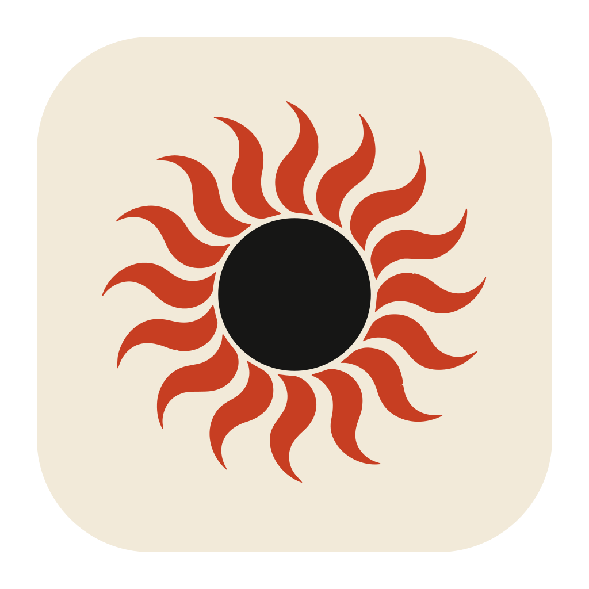

<p align="center"></p>

# Headroom

A small macOS menu bar app for brighter everyday desktop content on compatible XDR displays.

**0.4.0 · Community beta**

Headroom uses the extra brightness range that macOS makes available for HDR content. It stays in your menu bar, with an on/off switch and brightness slider for each display. There is no main window, account, screen recording, or continuous video playback.

## Install

1. Open [Releases](https://github.com/gorkamolero/Headroom/releases) and download **Headroom-0.4.0-community-beta-arm64.zip**.
2. Double-click the ZIP to extract it, then drag **Headroom.app** into **Applications**.
3. Open **Headroom** from Applications.

If macOS says the developer cannot be verified or Apple could not check the app:

1. Dismiss the message, then open **System Settings → Privacy & Security**.
2. Scroll to **Security** and click **Open Anyway** next to the message about Headroom.
3. Authenticate if asked, then click **Open** in the confirmation dialog.

That saves an exception for Headroom, so subsequent launches work normally. If **Open Anyway** is missing, try opening Headroom from Applications once more, then return to Privacy & Security. This is [Apple's per-app opening procedure](https://support.apple.com/102445). The beta is ad-hoc signed, not Developer ID signed or notarized. **You do not need to build from source to use the downloaded app.**

## Using Headroom

1. Click the black sun in the menu bar. Headroom starts **off**.
2. Enable a supported display and adjust its slider.
3. Switch it off to restore that display, or choose **Quit Headroom** to restore all active displays and exit.

Headroom saves the slider setting for each display. After sleep, wake, locking, or a display configuration change, enable boost again when you want it. If extra brightness is unavailable, the menu says so.

The app currently targets **Apple Silicon and macOS 13 or later**. Live testing has covered an M5 Pro MacBook Pro's built-in Liquid Retina XDR display on macOS 27.0.1. Other Mac, display, and OS combinations need confirmation. A display advertising EDR support may still have no extra brightness available under its current settings.

### Next beta: brightness keys and extra dimming

The local 0.5.0 candidate handles brightness keys automatically while running. This is not included in the public 0.4.0 download. On first use, Headroom requests Accessibility permission; allow it in **System Settings → Privacy & Security → Accessibility**. The menu reports when permission is needed. On a supported display:

- **Brighter:** hold Up through the normal brightness range and into boost at maximum.
- **Dimmer:** hold Down through the normal range to the 1% hardware setting, then into extra software dimming. Holding Up reverses the dimming, restores the saved color tables, and continues increasing hardware brightness.
- **Back from boost:** holding Down reduces boost, restores the saved color tables, and continues reducing hardware brightness.
- No release or second press is needed at either boundary. If the backlight is already at zero, Up raises hardware brightness; Down leaves it off.
- **Smaller steps:** hold **Option + Shift** while pressing a brightness key.

Headroom handles supported keys across the hardware, extra bright, and extra dim ranges and presents one compact overlay labeled **Display**, **Display +**, or **Display −**. It uses Apple's glass and slider controls on macOS 26 or later, with a compatible vibrancy panel on older versions: a white bar, evenly spaced tick marks, and sun icons that fade after the key press. If native brightness control is unavailable, ordinary keys fall back to macOS.

The local build 18 candidate extends the live **estimated nits** readout to **Display +**, as well as normal brightness and extra dimming. The overlay and per-display menu mark every estimate with **≈**. Normal brightness uses macOS's linear brightness reading and the active preset's SDR maximum; extra dimming includes an assumed sRGB response to the confirmed color-table adjustment.

For Display +, an uncalibrated model interpolates from that native reference toward the lower of the current EDR capacity and the active preset's HDR limit, using the adjustment confirmed by the recovery helper. Falling headroom lowers the estimate's ceiling. The tooltip identifies the model: this is neither a light-meter measurement nor a promise of sustained full-screen luminance. **— nits** means the required readings are unavailable or an adjustment is starting, restoring, or awaiting recovery. See the [calculation and its limits](docs/METHOD.md#estimated-nits--local-build-18). Build 17 introduced normal and dimmed nits; it showed **— nits** during boost. The public 0.4.0 download includes neither version of this feature.

The candidate's per-display menu slider covers a table factor from 0.1 through 1 (normal) to the available boost ceiling, at most 2.0. Extra dimming scales the same saved original color tables downward and does not start the HDR carrier. A factor of 0.1 does not mean 10% of physical brightness.

Switching a display off or quitting restores its original color tables. The hardware brightness you selected with the keys remains at its last setting, as it does with ordinary brightness controls. The 1% hardware floor is a slider setting, not a measured luminance percentage.

Keys target the built-in display when connected, otherwise the primary display; the per-display menu switches and sliders remain available. Keyboard control pauses while Lunar is running; Headroom never quits it for you. Physical-key repetition and the boundary handoff remain separate live checks. See the [validation record](VALIDATION.md) for results by build.

## Designed to restore your display

Headroom saves the original red, green, and blue display tables before changing them. Every slider adjustment starts from those originals, so adjustments cannot accumulate. A separate recovery helper watches the app, and a saved recovery record supports restoration after an interrupted session.

Recorded tests restored the original tables with an **exact numerical readback match**, including normal disable, lost communication, termination, and crash-recovery scenarios. The menu app also restored exactly after testing its maximum input scale. The [validation record](VALIDATION.md) identifies which app version and activation method each result covers.

These are concrete safeguards, not a promise that every hardware or macOS failure is impossible. This beta uses a public display API beyond its documented input range; compatibility and color behavior vary. If a session is interrupted, reopen Headroom with the affected display connected so it can process its saved recovery record. See [recovery and troubleshooting](docs/RECOVERY.md).

## How it works

Headroom presents a tiny, paused HDR surface to make EDR headroom available, then scales the display's saved RGB transfer tables. The HDR sample is generated by this project, silent, and loaded into a player that remains paused. Headroom does not capture or redraw other apps.

The slider controls a table multiplier up to 2.0, further limited by available headroom. **It is not a measured brightness multiplier or a promise of a particular nit level.** Brightness and color depend on the display, macOS, its preset, and ambient conditions. The [method](docs/METHOD.md) explains the implementation and its limits, with [Apple documentation](APPLE-SOURCES.md) alongside it.

## Privacy and permissions

Headroom runs locally. It has no telemetry, account system, network client, or automatic updater. It does not request Screen Recording, camera, microphone, or Full Disk Access permissions. It installs no login item or permanent background service.

The 0.4.0 release needs no Accessibility permission. In the development version, brightness-key handling starts automatically and requires Accessibility; the menu controls work without it. It checks event codes to recognize brightness buttons. Other keys pass through unchanged; typed characters are never read or recorded.

An update to an ad-hoc signed beta may require enabling Headroom in Accessibility again. These builds do not have a stable signing identity across versions; this is part of [macOS's app identity checks](https://developer.apple.com/documentation/technotes/tn3127-inside-code-signing-requirements).

The app stores per-display slider preferences and local recovery data. Recovery records contain display identifiers and the original color tables; they are retained when recovery needs another attempt. See [local data and removal](docs/RECOVERY.md#local-data-and-removal).

## Build from source

Use Xcode or Apple's Swift command-line tools on a Mac:

```sh
swift test
./scripts/build-menu-app.sh --beta "$PWD/dist/Headroom.app"
open "$PWD/dist/Headroom.app"
```

Building from source is optional and requires no Apple Developer membership. To use the packaged app, follow [Install](#install) above. [Release packaging](docs/RELEASING.md) documents the beta build and optional future notarization.

The source also includes `HeadroomLab`, the earlier bounded Metal experiment, for development. It is not part of the normal menu-bar experience.

## Feedback

Useful reports include your Mac model, macOS version, display model and connection, whether ordinary content becomes brighter, and whether switching off returns it to normal. Include the menu's error text when relevant. Avoid posting full recovery journals because they contain display identifiers.

See [release notes](docs/RELEASE-NOTES.md), [validation](VALIDATION.md), and [the technical method](docs/METHOD.md). Headroom is an independent project by Gorka Molero.
